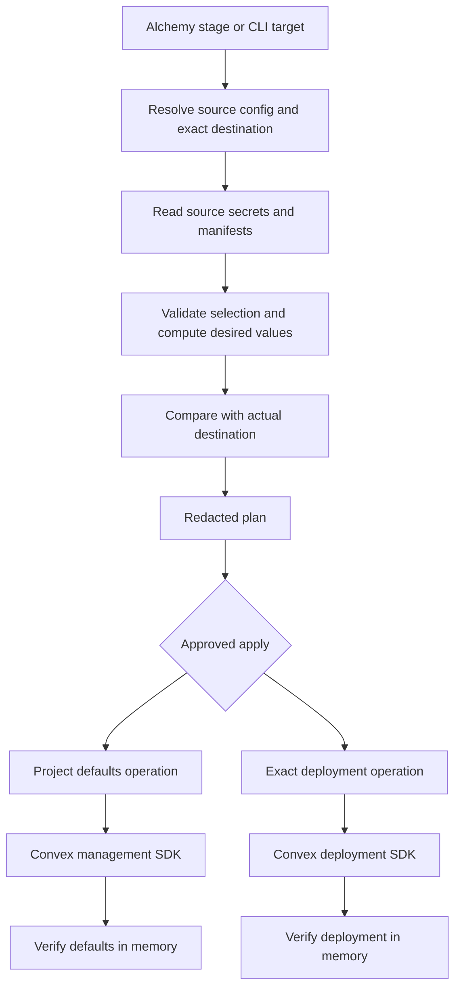

# Architecture

This document describes the implemented design. Source-checkout selection, read-only planning and ownership-aware reconciliation are implemented. Exact deployment planning/apply is implemented using Distilled with in-memory verification. Project/type defaults and explicit per-target propagation are also implemented. Alchemy lifecycle integration is implemented with fresh reads and metadata-only state. The shared CLI uses the same stage pipeline. Packed consumption is tested outside the source checkout; independent consumer acceptance covers local isolation, cloud development apply/rotation, preview initialization/override preservation and read-only development planning. Live production verification and npm publication remain outside that acceptance.

## Existing foundations

Use [Alchemy Doppler loading](https://alchemy.run/environments/doppler/) or the [Distilled Doppler SDK](https://github.com/alchemy-run/distilled/tree/main/packages/doppler) to read a config. Use [Distilled Convex](https://github.com/alchemy-run/distilled/tree/main/packages/convex) for management and deployment APIs. Do not recreate those clients or wrap the Convex CLI for the same operations.

The Convex SDK exposes `management.listDefaultEnvironmentVariables`, `management.updateDefaultEnvironmentVariables`, and `deployment.updateEnvironmentVariables`. SDK support is a foundation; the selection, target mapping and lifecycle rules below are the shared package's responsibility.

## Defaults and dedicated variables

Convex project defaults are keyed by deployment type: `dev`, `prod` or `preview`. They seed new deployments. Existing deployments retain their values unless changes are explicitly applied. The management API supports `applyToExistingDeployments`, but it can overwrite dedicated values. See [Convex environment variables](https://docs.convex.dev/production/environment-variables#project-environment-variable-defaults).

Project defaults sync and exact deployment sync must be separate operations. A central project configuration job owns defaults; an individual PR job owns only its exact preview deployment. Never infer a production target from a missing or unrecognized stage.

For an exact deployment, desired values are selected baseline values, then explicit deployment-specific source overrides, then explicitly declared Alchemy-generated overrides. Generated values such as an application's preview URL may differ from project defaults. Project defaults must not contain deployment-specific values.

Keep bulk propagation disabled by default. To rotate a baseline across existing deployments while preserving overrides, enumerate authorized targets and reconcile each complete desired set. If bulk propagation is explicitly enabled, prove its overwrite behavior and asynchronous completion before reporting success. A request being accepted is not completed verification.

## Source adapters

The engine consumes selected defaults and deployment overrides from an adapter. Doppler is first. An Infisical adapter may use a separate environment/folder mapping but must return the same validated engine input. Keep provider authentication, SDK dependencies and provider-specific names in the adapter. Alchemy and the CLI invoke the same engine.

Doppler project tags can identify participating projects, but do not select individual secrets. Use config-specific JSON key manifests, described in [configuration](configuration.md). An omitted key is not automatically permission to delete it. Missing selected secrets, malformed manifests and conflicting selection must fail before writes.

## Lifecycles

1. Sync project defaults through a separately authorized project-level operation.
2. Resolve or create the exact deployment through the consumer's existing provisioning workflow.
3. Apply and verify required environment values before deploying code that evaluates them during initialization.
4. Deploy the consumer using its existing workflow.
5. Reconcile later changes through an approved sync or an optional authenticated webhook-triggered job.

Preview branch source configs are optional. A deployment-specific overlay may come from a PR source config or explicit generated inputs; that choice must be declared. Untrusted PR code must not execute with production credentials. Production and preview sources must not fall back to each other.

Anonymous local worktree backends receive values directly, without relying on cloud project defaults or login. Each target has independent ports, data and generated local-only auth configuration. Do not overwrite a toolkit-generated local auth identity with a shared cloud credential. The consumer's worktree toolkit supplies the exact backend identity.

## State, ownership and verification

Store only non-secret ownership metadata: target identity, managed variable names and sync version. Never persist raw secrets or unkeyed hashes of secret values in Alchemy state, snapshots, logs or evidence. Redacted values alone are not a proven encrypted-state strategy. Inspect actual SDK/provider serialization before using it for secret-bearing resource inputs.

Observe actual values at sync time and compare in memory. Plans show names and operations, never values. Preserve unrelated keys. Deletions require a previously owned key and an explicit deletion declaration, scoped to one target. Missing source data, permission errors or absent configs must not become delete-all plans. Teardown retains shared defaults and secrets unless explicit removal is authorized.

An Alchemy adapter must re-observe drift even when its configuration has not changed. Do not use an input-hashed Action in a way that skips secret rotation because the project/config names are unchanged. The implementation must prove redaction, rerun and lifecycle behavior with pinned versions before release.
